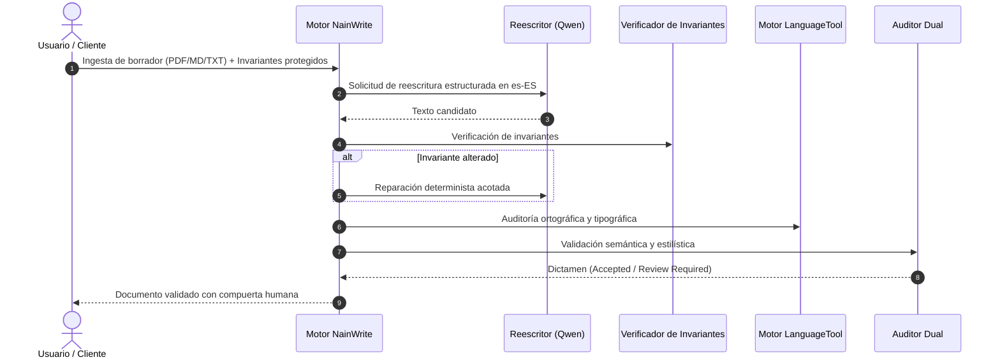

<picture>
  <source media="(prefers-color-scheme: dark)" srcset="docs/assets/banner-dark.svg">
  <source media="(prefers-color-scheme: light)" srcset="docs/assets/banner-light.svg">
  
</picture>

# NainWrite ES — Entorno de Reescritura Editorial en Español con Puertas Deterministas

[](README.md)
[](README.es.md)
[](tests/test_architecture.py)
[](https://github.com/Nain9Dev/nainwrite-es/actions/workflows/ci.yml)
[](https://write.naindev.com/)
[](https://status.naindev.com)
[](https://github.com/Nain9Dev/engineering-handbook)
[](https://github.com/Nain9Dev/engineering-handbook/blob/main/governance/zero-cost-philosophy.md)


NainWrite ES es un agente de reescritura local y determinista (*fail-closed*) para español de España natural, claro y profesional (`es-ES`). Reescribe borradores producidos por personas o modelos de lenguaje preservando el significado exacto, la incertidumbre, las condiciones, las negaciones, la atribución y los literales protegidos.

> **Demo Online Interactiva:** Prueba el banco de trabajo editorial directamente en [write.naindev.com](https://write.naindev.com/) con contratos de ejemplo, propuestas técnicas, análisis de diferencias (*diffs*) y compuertas de aprobación humana sin necesidad de instalar modelos locales.

## Flujo de Trabajo Actual

1. Qwen produce una reescritura estructurada mediante Ollama en ejecución local.
2. Un validador determinista compara los invariantes protegidos y los detectados automáticamente.
3. Se admite una reparación acotada si se detecta desviación determinista en literales o fechas.
4. LanguageTool en local valida ortografía, gramática y tipografía española. Una reparación lingüística acotada repite la comprobación de invariantes.
5. Un auditor dual independiente evalúa el significado y el estilo. Ambos deben certificar la salida antes de considerarse `accepted`; en caso contrario se marca como `review_required`.



## Arquitectura y Pruebas de Aptitud

Las fronteras arquitectónicas se validan automáticamente con pruebas AST:
- `spanish_rewriter.invariants` y `models`: Capa de dominio puro sin dependencias de HTTP ni CLI.
- `spanish_rewriter.service` y `evaluator`: Capa de orquestación desacoplada de la interfaz de usuario.
- `tests/test_architecture.py`: Pruebas continuas de aislamiento de capas ejecutadas en pytest.

## Ejecución Local

```bash
# Entorno virtual y dependencias
python -m venv .venv
.\.venv\Scripts\activate
pip install -r requirements-documents.txt

# Ejecutar suite de pruebas y reglas de arquitectura
pytest tests/ -v
```
