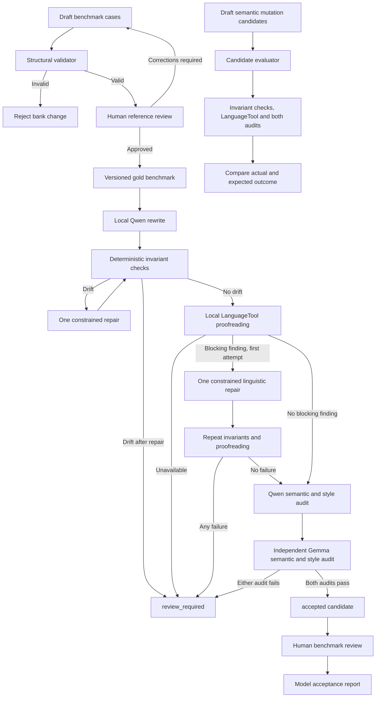
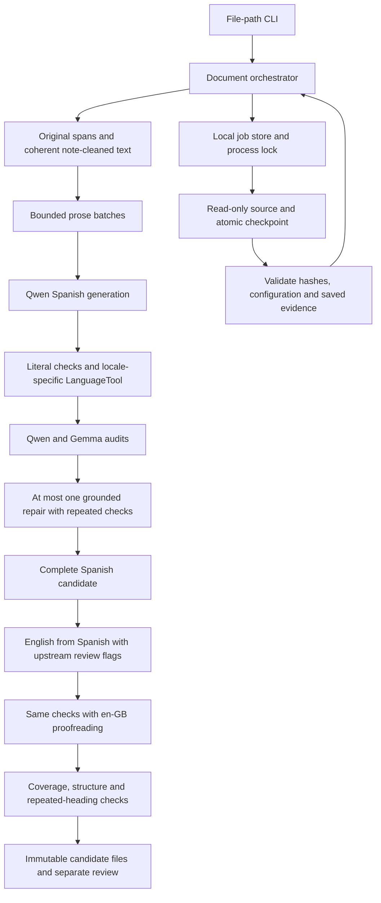

# Architecture

The benchmark is independent of the model runner. This prevents model-specific behavior from changing the evaluation contract. The runtime is a local fail-closed pipeline: no model result bypasses deterministic checks and semantic audit.

## Layer boundaries

- The benchmark stores inputs, constraints and review state.
- The validator reads the benchmark and reports structural errors.
- The model runner generates candidates but never modifies benchmark inputs or references.
- The rewrite service owns orchestration and status decisions.
- The invariant validator is deterministic and independent of model judgement.
- The loopback-only Ollama client owns local model I/O and JSON decoding.
- The loopback-only LanguageTool client owns proofreading I/O and service-identity validation. Spanish checking uses LanguageTool's `es` rules; the model prompts and human rubric enforce the `es-ES` register.
- Explicit protected literals and automatically detected invariants can suppress overlapping spelling findings, not grammar findings. Callers must not protect ordinary misspellings merely to bypass proofreading.
- The candidate evaluator measures deliberately invalid and valid pairs. It does not generate a rewrite and records all configured audit evidence.
- Human review owns naturalness and final semantic approval.

## Operational boundary

Both services run on the workstation. Ollama uses port `11434`; LanguageTool uses port `8082`. The unrelated Docker service on `8081` is untouched. Neither service requires a cloud account. A different model family is an independent implementation, not proof of statistically independent errors.

The default automatic gate requires semantic confidence of at least `0.95` and both style scores at `5/5` from each auditor. These are uncalibrated model judgements, not probabilities or guarantees of correctness. Rejected candidates remain available for human diagnosis but must not be automatically published.

A linguistic repair never applies LanguageTool replacement suggestions directly. It asks the writer for one new candidate grounded in the original source and preserves the pre-repair evidence. A repaired candidate must pass the same gates; an unavailable proofreader never triggers a repair.

The measured configuration rejects prompts above 12000 UTF-8 bytes and requests at most 2048 output tokens within a 16384-token context. The prompt budget includes instructions, constraints and candidate text, so the source-text allowance is smaller and varies by stage. Length-limited responses are rejected. The document workflow divides content instead of increasing this context.

## Document workflow

`document.py` owns parsing and deterministic assembly. `document_prompts.py` owns versioned bilingual instructions. `document_transform.py` owns bounded generation/checks/repair; `document_evidence.py` independently revalidates saved evidence. `document_job.py` orchestrates phases and status. Only `document_store.py` reads source files or persists local artifacts. The CLI captures arguments and presents progress; it does not implement editorial rules.

Each batch contains at most 12 source spans and 1800 UTF-8 source bytes. Complete prompts are checked again, including context and candidate text. Whole neighbours up to 256 bytes are included; larger neighbours are explicitly outside context coverage. No text is silently truncated. Cross-section semantic equivalence is not exhaustively established by these bounded audits.

Generated review-required candidates are local review artifacts, not external publication. Source-specific preparation ranges and documents never belong in the repository.

Parser v2 removes approved editorial markers within each prose region before segmentation. Exact original text and cleaned model text have separate hashes. Only spacing directly affected by removal is normalized; protected code/links and existing line-ending suffixes remain intact. Identical original headings are compared across both completed languages; variants require review, not automatic replacement. A new parser/prompt/job version requires a new job instead of migrating prior model evidence.
