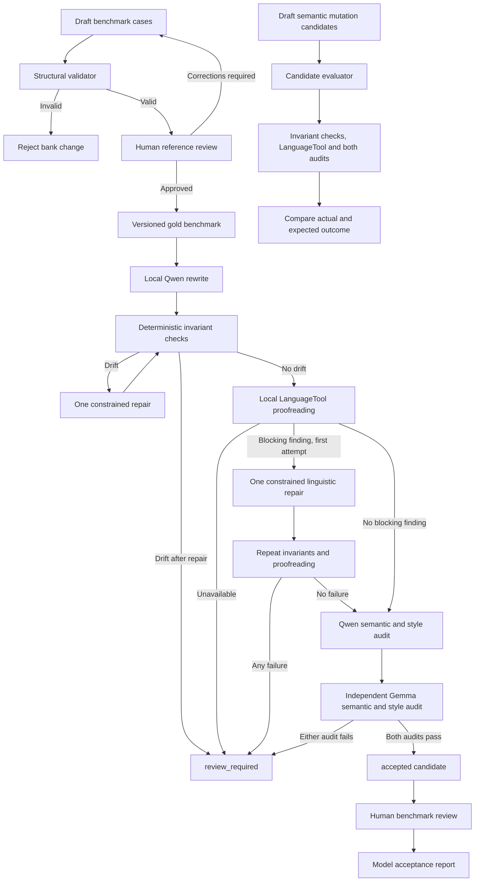

# Architecture

The benchmark is independent of the model runner. This prevents model-specific behavior from changing the evaluation contract. The runtime is a local fail-closed pipeline: no model result bypasses deterministic checks and semantic audit.

## Layer boundaries

- The benchmark stores inputs, constraints and review state.
- The validator reads the benchmark and reports structural errors.
- The model runner generates candidates but never modifies benchmark inputs or references.
- The rewrite service owns orchestration and status decisions.
- The invariant validator is deterministic and independent of model judgement.
- The loopback-only Ollama client owns local model I/O and JSON decoding.
- The loopback-only LanguageTool client owns proofreading I/O and service-identity validation. Spanish checking uses LanguageTool's `es` rules; the model prompts and human rubric enforce the `es-ES` register.
- Explicit protected literals and automatically detected invariants can suppress overlapping spelling findings, not grammar findings. Callers must not protect ordinary misspellings merely to bypass proofreading.
- The candidate evaluator measures deliberately invalid and valid pairs. It does not generate a rewrite and records all configured audit evidence.
- Human review owns naturalness and final semantic approval.

## Operational boundary

Both services run on the workstation. Ollama uses port `11434`; LanguageTool uses port `8082`. The unrelated Docker service on `8081` is untouched. Neither service requires a cloud account. A different model family is an independent implementation, not proof of statistically independent errors.

The default automatic gate requires semantic confidence of at least `0.95` and both style scores at `5/5` from each auditor. These are uncalibrated model judgements, not probabilities or guarantees of correctness. Rejected candidates remain available for human diagnosis but must not be automatically published.

A linguistic repair never applies LanguageTool replacement suggestions directly. It asks the writer for one new candidate grounded in the original source and preserves the pre-repair evidence. A repaired candidate must pass the same gates; an unavailable proofreader never triggers a repair.

The measured configuration rejects prompts above 12000 UTF-8 bytes and requests at most 2048 output tokens within a 16384-token context. The prompt budget includes instructions, constraints and candidate text, so the source-text allowance is smaller and varies by stage. Length-limited responses are rejected. Whole-document segmentation and long-context acceptance remain unimplemented.
