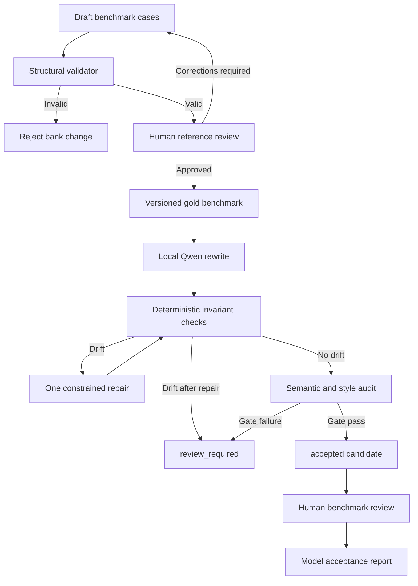

# Architecture

The benchmark is independent of the model runner. This prevents model-specific behavior from changing the evaluation contract. The runtime is a local fail-closed pipeline: no model result bypasses deterministic checks and semantic audit.

## Layer boundaries

- The benchmark stores inputs, constraints and review state.
- The validator reads the benchmark and reports structural errors.
- The model runner generates candidates but never modifies benchmark inputs or references.
- The rewrite service owns orchestration and status decisions.
- The invariant validator is deterministic and independent of model judgement.
- The loopback-only Ollama client owns local model I/O and JSON decoding.
- Human review owns naturalness and final semantic approval.
