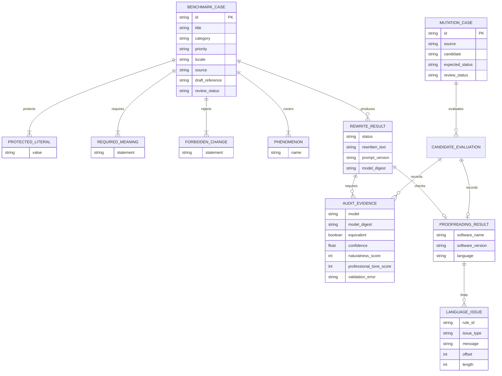
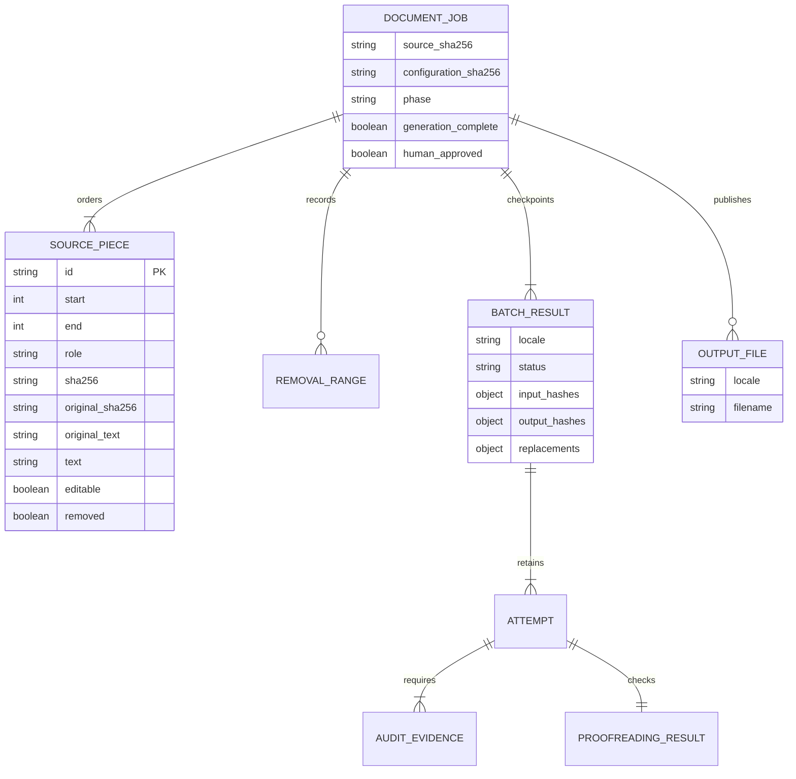
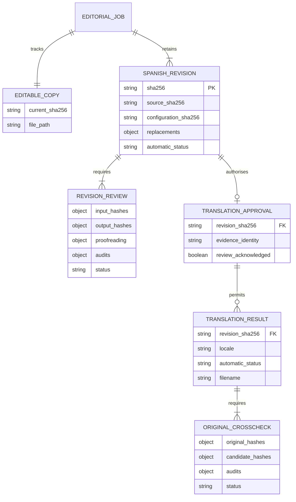
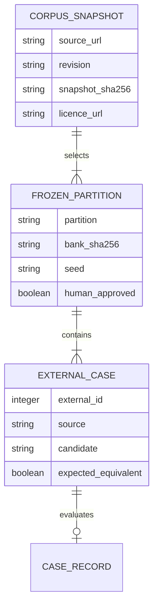
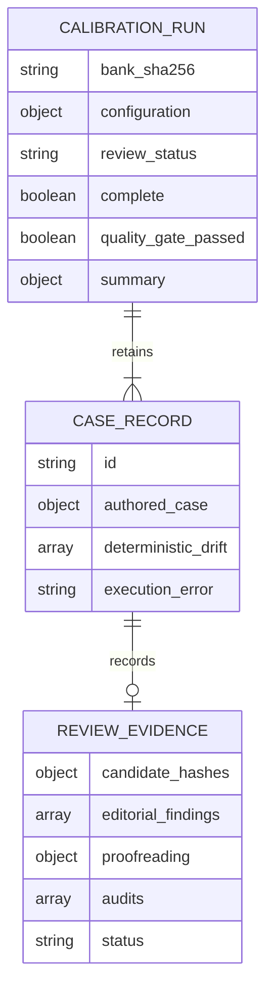
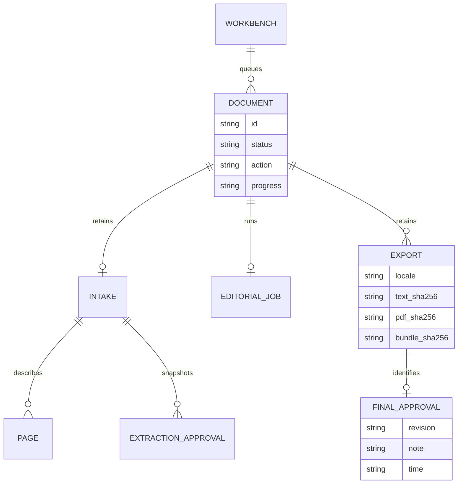

# Data Model

The first version uses one self-contained JSON object per line. Arrays are embedded because each case is independently reviewed and executed.

## Status values

- `draft`: generated or edited reference awaiting human approval.
- Future values require an approved ADR before being introduced.

Runtime statuses are separate from reference review state: `accepted` means that configured automatic checks passed; `review_required` means at least one check rejected or could not validate the candidate. Neither changes a reference from `draft` to gold.

Reports also contain detected invariants, blocking/advisory/ignored language findings, generation timing and token counts. Reports are local artifacts and are not repository data or a persistence database.

## Document jobs

Offsets index Unicode source characters; each span and removal retains exact source text locally. The checkpoint envelope contains a SHA-256 of canonical state to detect corruption, not a cryptographic signature or protection against a malicious local writer. Resumption reconstructs the manifest and verifies source/configuration/model identity, coverage, candidate hashes, original audit responses, proofreading classifications and derived statuses. A process lock prevents simultaneous runners from modifying one job.

In parser v2, `original_text` always matches the exact source slice. `text` is the cleaned model input, which can exclude recorded preparation notes inside that slice. Concatenating all original slices reproduces the complete source; assembling replacements produces the cleaned candidate. This prevents artificial sentence fragments while retaining a lossless audit trail. Old manifests are intentionally incompatible.

## Spanish revisions and translation authority

This is the conceptual specification-005 model; serialized fields are versioned by the runtime. Review-only evidence has no synthetic writer generation: it records actual candidate bytes, checks and audit responses. Approval is local workflow authority tied to a revision, not an authenticated signature or a guarantee that a named person approved it. A local attacker able to rewrite state remains outside the corruption-detection threat model.

An editable-copy change revokes current translation authority. Old snapshots, reviews and translations remain available, but are not the current document version. Completion, automatic quality, human translation approval and stale-history status must not be conflated.

## Calibration evidence

External evaluation adds corpus provenance and partition identity to the retained
bank without changing the existing review evidence contract.

External semantic labels have no associated corporate-style approval. Only the
evaluation partition is used in the baseline; the reserve remains unexamined.

Each record holds either complete review evidence or an explicit local model execution error. Per-case files are immutable; checkpoint state allows validated completed records to be reused. `complete` means all cases were attempted, whereas `quality_gate_passed` requires all expected semantic/style outcomes and no execution errors. The fixed draft review status is never gold approval. Configuration includes the editorial-rule version as well as prompt/model identities.

## Workbench records

Workbench state is atomically replaced JSON. Original bytes, page previews,
images, approved snapshots and exports are retained separately. Editing Spanish
invalidates current exports and final approvals; old files remain on disk.
Hashes detect accidental/tampered changes but do not authenticate the local user.
