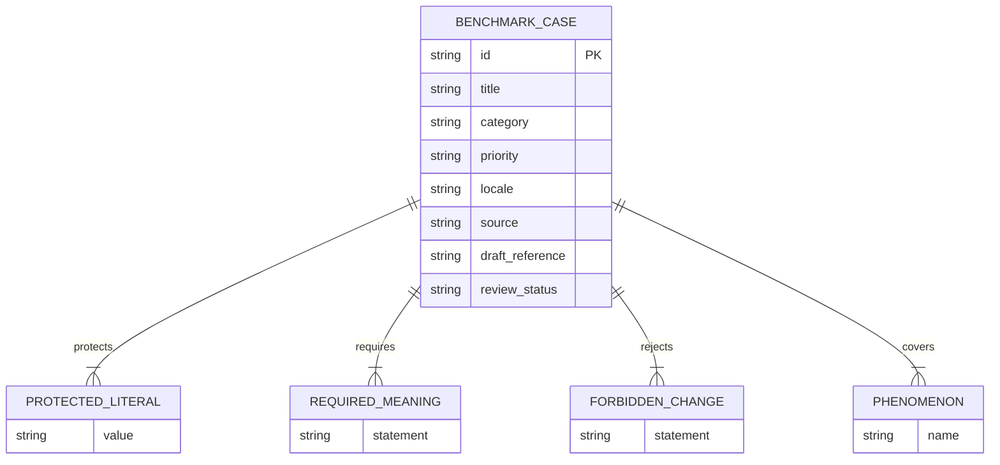

# Data Model

The first version uses one self-contained JSON object per line. Arrays are embedded because each case is independently reviewed and executed.

## Status values

- `draft`: generated or edited reference awaiting human approval.
- Future values require an approved ADR before being introduced.
