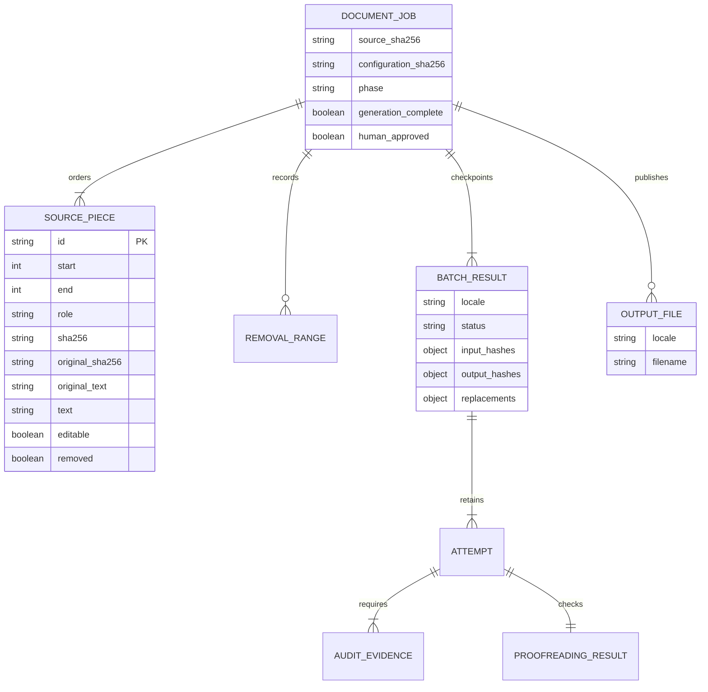

# Data Model

The first version uses one self-contained JSON object per line. Arrays are embedded because each case is independently reviewed and executed.

## Status values

- `draft`: generated or edited reference awaiting human approval.
- Future values require an approved ADR before being introduced.

Runtime statuses are separate from reference review state: `accepted` means that configured automatic checks passed; `review_required` means at least one check rejected or could not validate the candidate. Neither changes a reference from `draft` to gold.

Reports also contain detected invariants, blocking/advisory/ignored language findings, generation timing and token counts. Reports are local artifacts and are not repository data or a persistence database.

## Document jobs

Offsets index Unicode source characters; each span and removal retains exact source text locally. The checkpoint envelope contains a SHA-256 of canonical state to detect corruption, not a cryptographic signature or protection against a malicious local writer. Resumption reconstructs the manifest and verifies source/configuration/model identity, coverage, candidate hashes, original audit responses, proofreading classifications and derived statuses. A process lock prevents simultaneous runners from modifying one job.

In parser v2, `original_text` always matches the exact source slice. `text` is the cleaned model input, which can exclude recorded preparation notes inside that slice. Concatenating all original slices reproduces the complete source; assembling replacements produces the cleaned candidate. This prevents artificial sentence fragments while retaining a lossless audit trail. Old manifests are intentionally incompatible.
