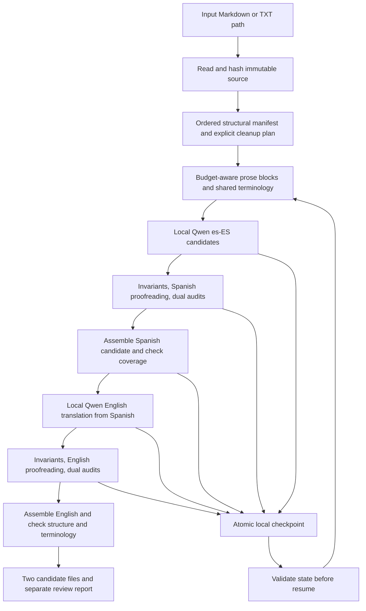
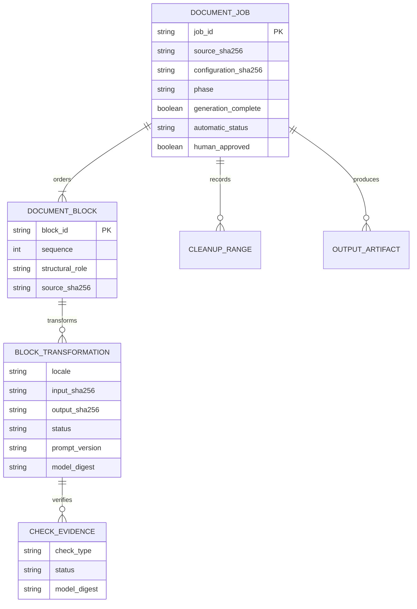

# Bilingual Document Rewriting Plan

Status: Design approved by Aitor on 2026-09-04; implementation in progress.

## External prerequisites

- `[A]` Existing Python runtime, Qwen writer, Gemma auditor and local LanguageTool.
- `[A]` Read-only preflight of the exact installed model digests and available Spanish/English proofreading languages.
- `[M]` Approval of this written technical design, including initial Markdown/TXT scope and `en-GB` output: received on 2026-09-04.
- `[H]` No new account, credential, paid resource or cloud inference is required.
- `[A]` Ollama remains unchanged as requested. Calls use `127.0.0.1`; no claim of loopback-only server binding is made.

## Options considered

1. **Recommended: a resumable document orchestrator around shared local components.** Preserve the existing short-text service and add explicit parsing, bilingual transformation, checkpoint and assembly responsibilities. This is testable and provides the requested file-path workflow.
2. **Manual section-by-section CLI calls.** Useful for a one-off experiment, but insufficient for coverage guarantees, consistent terminology, safe resumption and repeated use with arbitrary paths.
3. **One oversized context request.** Rejected for the current implementation: the example already exceeds the request limit, and a single response would not provide reliable progress checkpoints or structural coverage.

## Proposed architecture



The CLI captures arguments and displays progress. The application service orchestrates the job. Parsing, protected-span handling, segmentation and validation remain separate from I/O. A local job store alone reads/writes checkpoint artifacts. Models receive data-only bounded contexts, not filesystem access or document-supplied commands.

The existing Spanish short-text API retains its behavior. New bilingual prompts and audit routing must not be implemented by falsely labelling English as Spanish in the current service. LanguageTool gains an explicit validated language setting while preserving its existing Spanish default and security controls.

## Proposed data relationships



Source spans and candidate text remain local. Manifest identity and output assembly must not depend on model-generated section numbering. A resuming job validates stored state as data; it never executes it.

## Proposed interface

These commands are a design, not currently available commands:

```powershell
python tools/rewrite_document.py --input "C:/path/draft.md" --both
python tools/rewrite_document.py --resume "C:/path/draft.rewritten/job-id"
```

Default output is a new job directory beside the source. It contains separate `es-ES` and `en-GB` files, a review report and resumable state. Names include a draft/review marker when required. No input or prior result is overwritten. An explicit output-directory option supports keeping generated files elsewhere.

Both language files can be produced for review in one run. This is not the same as human approval of the Spanish stage: upstream findings remain visible in the job status and propagate to English. Incomplete generation produces checkpoints/partial evidence, not fake complete files.

## Implementation sequence

1. `[M]` Review and approve the written design.
2. `[A]` Add failing tests for immutable file handling and lossless structural parsing/assembly before implementing those components.
3. `[A]` Add failing tests for budget-aware segmentation and protected spans before implementing them.
4. `[A]` Add checkpoint and incompatible-resume tests before implementing the job store.
5. `[A]` Add bilingual prompt/proofreader/audit tests before implementing transformation services.
6. `[A]` Add end-to-end synthetic CLI tests, status propagation and artifact naming before connecting the workflow.
7. `[A]` Run all unit tests and synthetic real-model smoke tests, then obtain independent code review.
8. `[A]` Run the supplied document locally, inspect both complete outputs and compare structure, protected values and linguistic findings. Do not revise failed expected outcomes merely to obtain a pass.
9. `[A]` Update traceability, architecture, data model, runbook and handoff with exact measured evidence.
10. `[M]` Present both candidate files and unresolved findings; user approval remains distinct from automatic acceptance.

## Stop conditions

- An input format or protected construct cannot be parsed and reassembled safely.
- Required content cannot fit the bounded request even after safe splitting.
- A local service, model digest or required proofreading language is unavailable.
- A proposed repair changes content merely to satisfy a checker.
- An implementation would require cloud processing, changing Ollama or writing customer text into Git.
- The original changes during a job or resume state does not match the active configuration.

## Execution detail

The approved subsystem is tightly coupled, so implementation proceeds inline with an independent read-only code review. The existing dedicated feature branch is retained; no main-branch change or merge is included.

### Task 1: Lossless manifest and bounded batches

Files: create `src/spanish_rewriter/document.py` and `tests/test_document.py`.
Interface: `parse_document(text, *, markdown=True, clean_notes=False, omit_lines=()) -> Manifest`; `Manifest.assemble(replacements) -> str`; `make_batches(manifest) -> list[list[Piece]]`.

- [ ] Write round-trip, note range, protected-span, table, unsafe-format, long-paragraph and coverage tests.
- [ ] Run `python -m unittest discover -s tests -p test_document.py -v`, observe missing-module failure, then implement and rerun.
- [ ] Keep literal source spans and immutable separators. Batch multiple editable spans within the request budget to avoid one model load per table cell.

### Task 2: Bilingual transformation and evidence

Files: create `document_prompts.py`, `document_transform.py`, `tests/test_document_transform.py`; modify `language_tool.py` and its tests.
Interface: `DocumentTransformer.transform(items, locale, context) -> dict`; configuration includes prompt version, exact model digests and proofreading settings.

- [ ] Write failing tests for en-GB request/response identity, stable item IDs, missing/duplicate IDs, bounded prompts, protected literals and both audits.
- [ ] Add explicit language routing without changing the existing Spanish default.
- [ ] Generate bounded JSON arrays, run proofreading and two distinct model audits, keep all evidence and allow at most one grounded repair.

### Task 3: Job store, orchestration and CLI

Files: create `document_store.py`, `document_job.py`, `tools/rewrite_document.py`, `tests/test_document_job.py`.
Interface: `start_job(input_path, transformer, ...) -> Path`; `run_job(job_dir, transformer, progress=...) -> dict`.

- [ ] Write interruption/resume/config/source/tamper/collision tests and an end-to-end synthetic test before runtime changes.
- [ ] Atomically checkpoint each phase and batch. Generate all Spanish blocks before starting English, which consumes only Spanish replacements.
- [ ] Validate exact coverage and source identity before publishing separately named candidate files and reports. Retain unapproved status and upstream failures.
- [ ] Run the full test suite, independent review, real synthetic inference, then the named private document outside Git.

No extra installation or external service is required. Private cleanup ranges are supplied explicitly and retained only in local job state; there is no source-specific document content in the repository.

## Measured editorial refinement

The first full-document evaluation exposed artificial sentence boundaries around removed notes and literal technical calques. The current job is not mutated. A new parser/prompt version will be tested and run as a new job after the baseline finishes.

- Clean each editable structural region before safe segmentation, retaining both its exact original source span and its cleaned model text. Normalize horizontal spaces only at recorded note-removal joins; preserve code, structural delimiters, line endings and hard breaks. Reject ambiguous joins without spacing.
- Proofread the resulting coherent sentence regions instead of synthetic fragments around omitted notes.
- Extend the bounded bilingual glossary and calibrated style instructions for technical prose, without changing model identities, sampling or Ollama configuration.
- Preserve the technical meaning of manifold analysis through both translation stages. The baseline round trip produced a generic variety analysis; add a contextual glossary pair and a synthetic negative/conditional example before the next full evaluation.
- Detect inconsistent translations of identical source headings in final checks; do not silently choose a preferred translation.
- Add failing-first tests, rerun the full suite and request a scoped independent review before the new real job. Reject resumption of the old parser version rather than rewriting its historical evidence.
- Add bounded atomic-checkpoint retries for transient Windows file-reader locks. Reproduce with a synthetic held-open checkpoint before implementation; verify successful retry, exhausted failure, preserved prior state and cleanup of temporary files.
