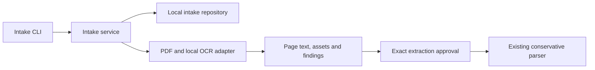
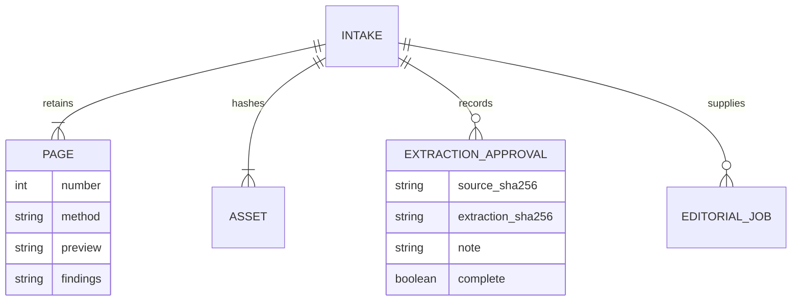

# Plan

1. `[A]` Specify immutable intake identity, editable extraction and review authority.
2. `[A]` Add failing tests for full page coverage, OCR, asset confinement, changed approvals and blocked incomplete extraction.
3. `[A]` Implement repository persistence, local PDF/OCR adapters and intake service; CLI remains argument presentation only.
4. `[A]` Test native, scanned, table, multi-column, image, footnote and link fixtures without private data.
5. `[A]` Inspect rendered fixture pages and handoff to the existing parser. Update traceability and handoff before the next slice.

## Architecture

