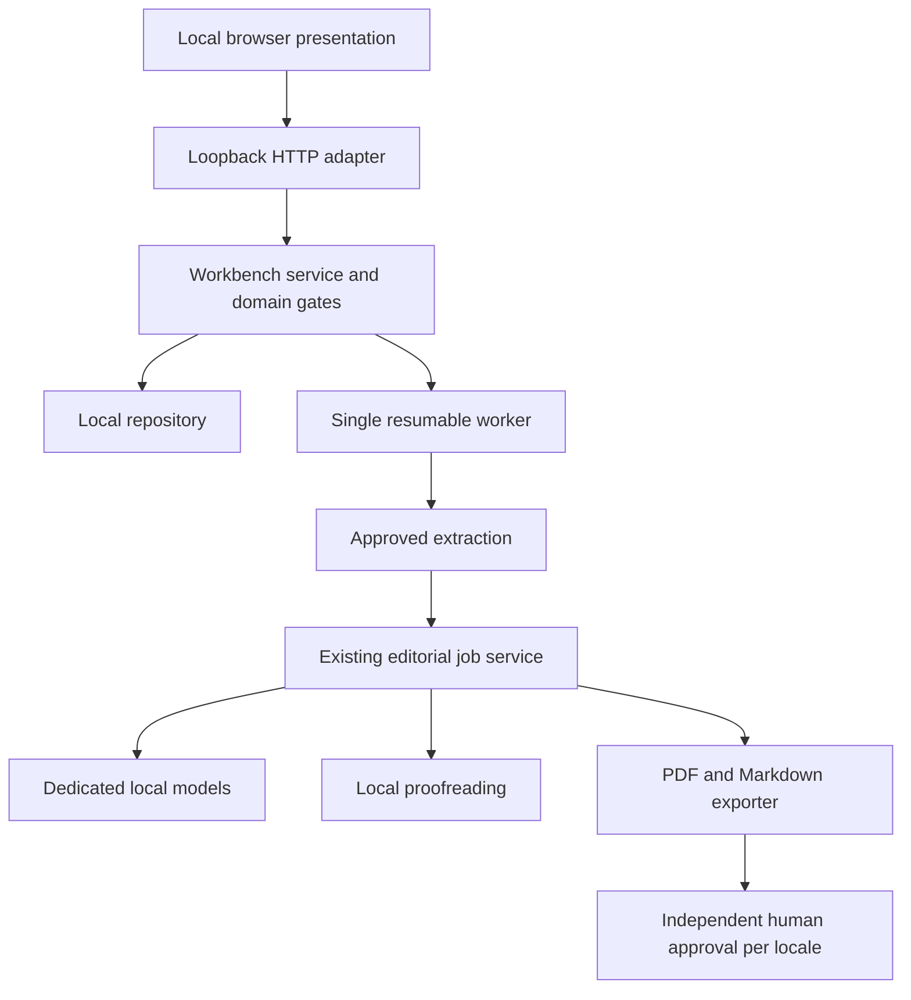
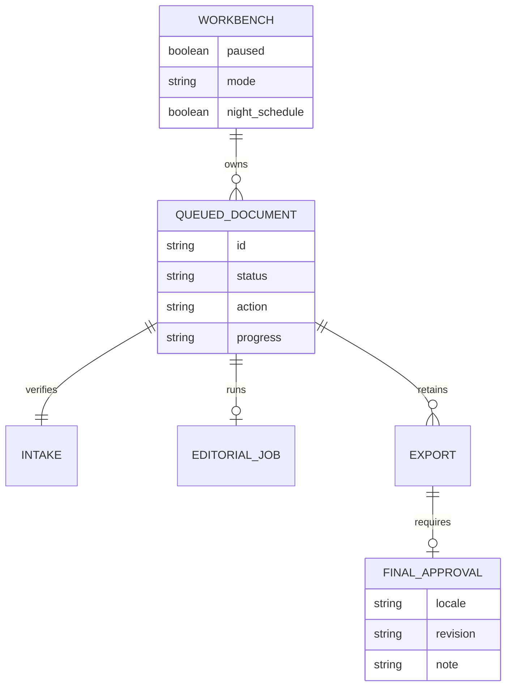

# Plan

1. `[A]` Add failing tests for queue transitions, approval gates, export fidelity and request boundaries.
2. `[A]` Implement repository, workbench service, safe export adapter and single worker around existing editorial jobs.
3. `[A]` Add a loopback HTTP presentation adapter and local HTML/CSS/JavaScript review surface.
4. `[A]` Verify service recovery, tampering, pause/resume and both locale paths with synthetic model contracts; inspect real exported PDF and browser states.
5. `[A]` Run a bounded real local-model Spanish smoke up to the human approval gate; never approve real output on Aitor's behalf.
6. `[A]` Document startup, limitations, evidence and handoff. `[M]` Present the actual Spanish candidate for review.

