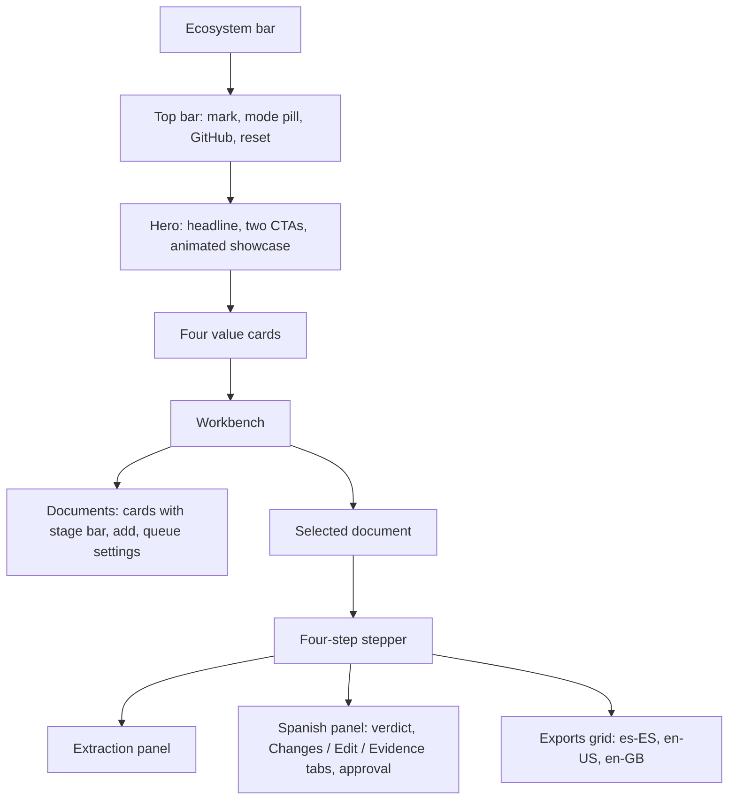

# Implementation Plan - Client Visual Redesign

## Files

| File | Change |
| --- | --- |
| `src/spanish_rewriter/web/index.html` | New structure: top bar, hero with showcase, value strip, workbench with stepper, stage panels, tabs and export grid. Same element ids. No inline handlers or styles. |
| `src/spanish_rewriter/web/app.css` | Full rewrite on local NainDev tokens: paper, blue inks, Urbanist and IBM Plex Mono fallbacks, 4 px radius, solid-offset shadows, stroke icons. Responsive at 375 px. Reduced-motion rules. |
| `src/spanish_rewriter/web/app.js` | Same API routing and actions. Adds stepper, tabs, visual comparison, literal chips, status chips, toast notice, local-mode class, drag and drop upload, reset bound in script. |
| `src/spanish_rewriter/web/diff.js` | Pure functions: tokenise, LCS word diff, segment count, literal extraction. Shared by the client and the demo engine. |
| `src/spanish_rewriter/web/showcase.js` | Hero animation: replays bundled example sentences through detect, rewrite and verify phases. No network. Static final state under reduced motion. |
| `src/spanish_rewriter/web/mock-workbench.js` | Uses `diff.js` for a real unified diff and adds `automatic_status` to seeded results. Contracts unchanged. |
| `src/spanish_rewriter/web/favicon.svg` | Brand mark: three strokes, round caps. |
| `src/spanish_rewriter/workbench_http.py` | Generic same-origin static rule for `.js`, `.css`, `.svg` inside the web directory. |
| `tests/test_web_client.py` | DOM id contract, CSP-compatible markup, static file serving and traversal refusal. |

## Layout

Local mode adds `app--local` to `<html>`; CSS hides the hero and value strip.

## Comparison algorithm

Tokens are words and whitespace runs. A longest-common-subsequence over tokens
(capped at 3000 tokens per side, line fallback above) yields `equal`, `del` and
`ins` runs. Literal detection uses one regular expression for currency, percent,
numbers with Spanish separators and day-month-year dates. A literal is marked
present when its exact string occurs in the Spanish text.

## Verification

1. `python -m unittest tests.test_web_client -v` fails before the server change and
   passes after.
2. Full suite `python -m unittest discover -s tests -v`.
3. Manual browser pass at desktop and 375 px: landing, showcase cycle, the three
   seeded documents, edit and save, translate, final approvals, upload of a `.txt`.
